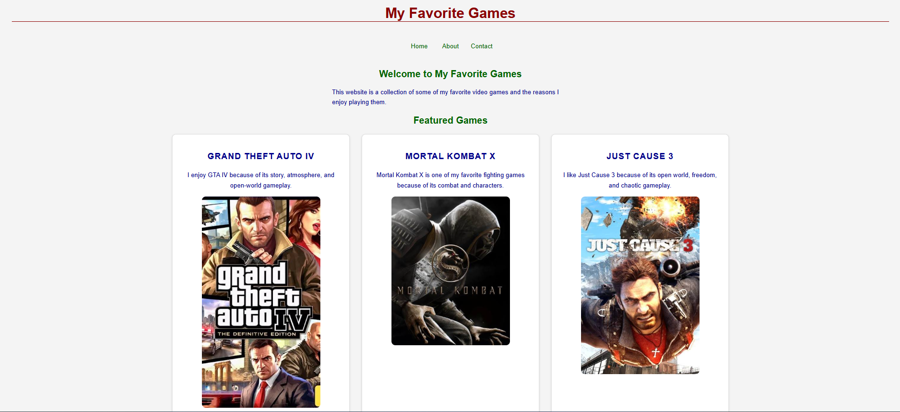

# My Favorite Games

A simple three-page website showcasing some of my favorite video games.

## About
This website is a collection of some of my favorite video games. It includes information about the games I enjoy and a contact form for visitors to send game recommendations or messages.

## Pages
- **Home:** Introduces the website and highlights three favorite games.
- **About:** Explains my gaming interests and why I enjoy these games.
- **Contact:** Includes a form where visitors can send their name, email, and message.

## Technologies Used
- HTML5
- Git
- GitHub
- Vercel

## CSS Design Notes

- Background: Light gray (#f4f4f4).
- Cards: White backgrounds with rounded corners, subtle borders, and shadows.
- Typography: Arial font with different heading sizes and colours.
- Spacing: Margin and padding are used to improve readability.

### CSS Box Model

The CSS box model consists of content, padding, border, and margin.
Padding creates space inside an element, while margin creates space outside it.

## Flexbox vs. CSS Grid

I use Flexbox when I want to arrange items along one main direction, such as navigation links in a row. I use CSS Grid when I want to organise items into both rows and columns, such as a gallery of game cards.

## Responsive Design Testing

I tested the website at different viewport widths using Chrome DevTools.

| Viewport | Description | Result |
|---|---|---|
| 375px | Mobile layout | Passed |
| 767px | Just before tablet breakpoint | Passed |
| 768px | Tablet breakpoint | Passed |
| 1023px | Just before desktop breakpoint | Passed |
| 1024px | Desktop breakpoint | Passed |
| 1440px | Large desktop layout | Passed |

## How to Run Locally

1. Clone or download this repository.
2. Open the project folder in Visual Studio Code.
3. Open `index.html` in your browser, or use the Live Server extension in VS Code.

## Links
- **Live Website:** https://my-favorite-games-nine.vercel.app/
- **GitHub Repository:** https://github.com/Vigz1/my-favorite-games

## Author

Created by Francis Akabogu as part of my AI Frontend Web Development learning journey.